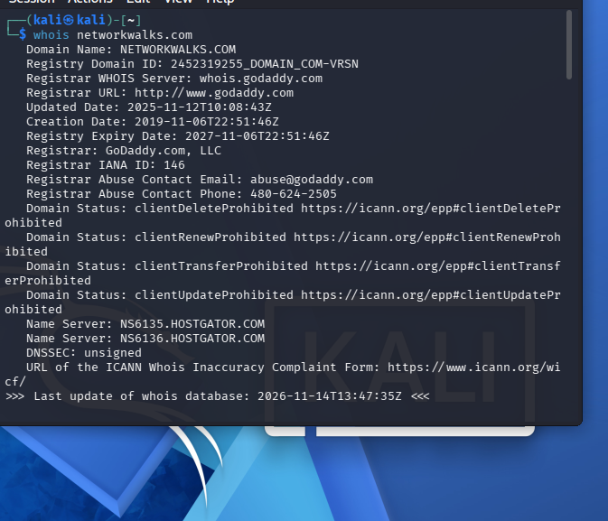
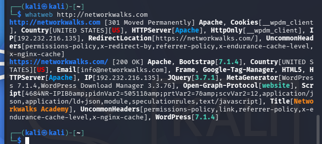
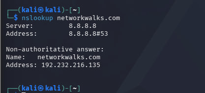
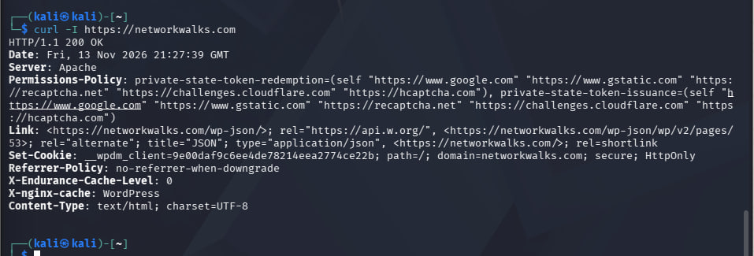
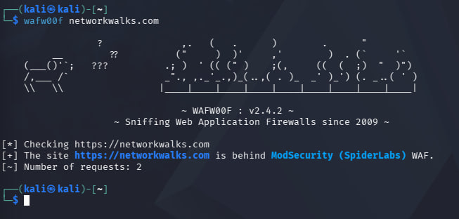
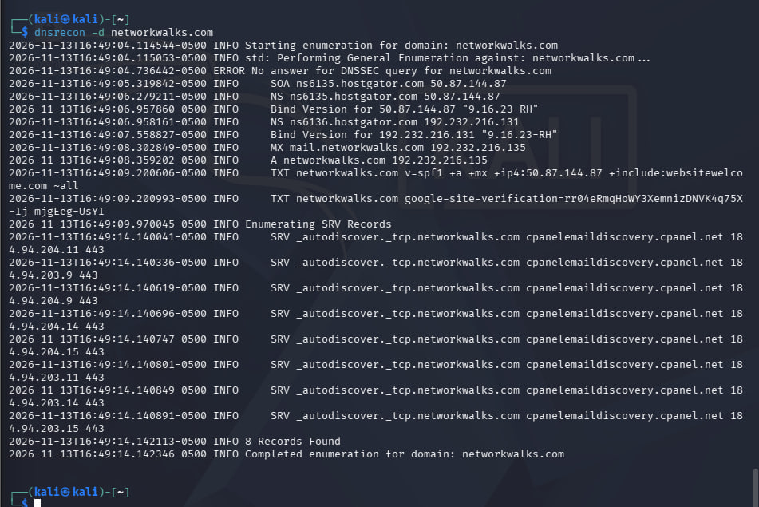
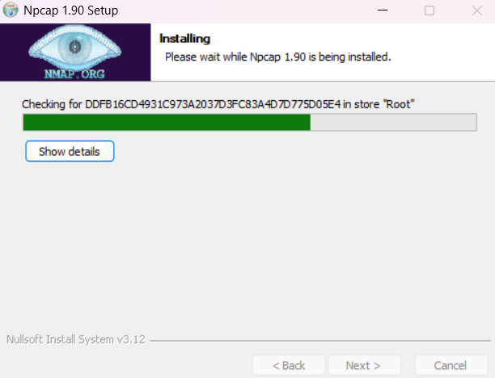
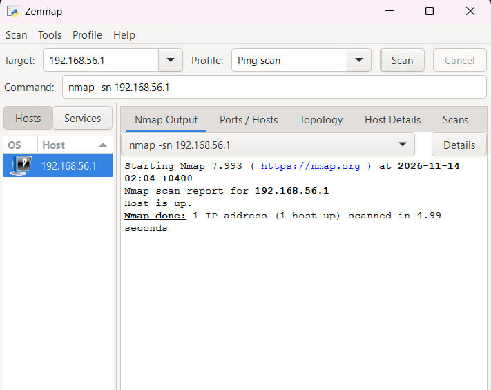
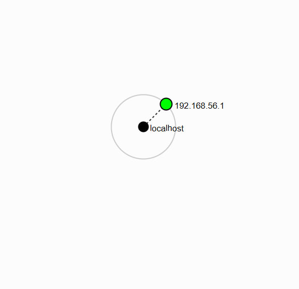

# PENETRATION TESTING REPORT
### Footprinting & Network Scanning Phases

**W2-PM-FINAL | CYBERSECURITY | NETWORKWALKS**

---

## Project Information

| Field | Details |
|---|---|
| **Pentester Name** | Beamlak Fiseha |
| **Program/Batch** | B084C-Networkwalks |
| **Date** | 14 November 2026 |
| **Modules Completed** | W2-PM1 (Multiple Kali Tools), W2-PM5 (Zenmap Scanning) |
| **Client/Target** | 1. Networkwalks (written permission secured) |
| | 2. Local VirtualBox Host-Only Lab Network |
| **Permission Secured** | Yes |
| **Phase 1** | Reconnaissance & Footprinting |
| **Phase 2** | Scanning & Network Discovery |
| **Phases 3–5** | In Progress |

---

## 1. Liability Disclaimer

This report documents educational reconnaissance and host-discovery activities. Network discovery was limited to the local VirtualBox Host-Only subnet, rather than the shared Wi-Fi.

The findings do not demonstrate exploitation or unauthorized access. Any testing of third-party websites must remain within an explicitly authorized scope.

---

## 2. Introduction

Week 2 combines introductory web footprinting tools with network scanning through the Zenmap graphical interface for Nmap.

The aim is to understand how public-facing technical information and locally discoverable hosts can be observed and documented responsibly.

This report records the results obtained during the practical activities, including website reconnaissance, network discovery, and the security observations associated with each exercise.

---

## 3. Tools Used

The following tools were used to perform reconnaissance and network scanning activities.

| Tool | Purpose |
|---|---|
| **Kali Linux & Windows** | Operating systems used for reconnaissance and network scanning |
| **WHOIS** | Retrieve domain registration details, registration dates, and name servers |
| **WhatWeb** | Identify web technologies, web servers, CMS platforms, and plugins |
| **Nslookup** | Resolve domain names to IP addresses using DNS |
| **Curl (`-I`)** | Retrieve and examine HTTP response headers |
| **Wafw00f** | Identify Web Application Firewall technologies |
| **DNSRecon** | Enumerate DNS records, including NS, MX, TXT, and SRV records |
| **Zenmap (Nmap GUI)** | Discover active hosts, identify IP and MAC addresses, and visualize network topology |
| **Windows CMD** | Identify local network configurations and adapter information |

---

## 4. Activities Performed

### 4.1 Footprinting & Reconnaissance

As part of the reconnaissance phase, I examined the **networkwalks.com** domain using six tools available in Kali Linux: **WHOIS, WhatWeb, Nslookup, Curl, Wafw00f, and DNSRecon**. Each tool helped me gather specific information about the website, its technologies, and its underlying infrastructure.

I began with **WHOIS** to investigate the domain's registration details. This allowed me to retrieve publicly accessible information, including the domain's name servers, registration records, and other details associated with its hosting infrastructure.

Next, I used **WhatWeb** to examine the technologies running on the website. The scan revealed that the website uses **WordPress 7.1.4 and WP Download Manager 3.3.76**, along with additional information about the web server and its configuration.

I then performed a DNS lookup using **Nslookup** to determine the IP address associated with the domain. The lookup returned **192.232.216.135**, demonstrating how a domain name can be resolved to its corresponding server address.

After that, I executed **Curl** with the `-I` option to retrieve and examine the website's HTTP response headers. This helped me understand how the server responds to requests and identify technical information, including a reference to the WordPress REST API endpoint, `/wp-json/`.

To investigate the website's security protection, I used **Wafw00f**, which detected **ModSecurity (SpiderLabs)** as the Web Application Firewall (WAF). This provided insight into the security technology used to filter and monitor incoming web traffic.

Lastly, I performed DNS enumeration using **DNSRecon**. The results provided information about the domain's DNS infrastructure, including name servers, mail servers, SPF/TXT records, and service-related records.

Through these activities, I gained practical experience using reconnaissance tools to collect and interpret publicly available information about a target website without attempting to exploit any vulnerabilities.

### 4.2 Network Scanning with Zenmap

For the network scanning phase, I used **Zenmap**, the graphical user interface of Nmap, to identify active hosts within my local network.

The objective of this activity was to determine the network's IP address range, discover available hosts, examine their IP and MAC addresses, and visualize the network topology.

I began by running the `ipconfig` command in Windows Command Prompt to examine my network configuration.

From the results, I identified the IP address **192.168.56.1**, associated with my VirtualBox Host-Only network. I selected this network for the practical exercise to avoid scanning devices connected to the shared Wi-Fi.

Next, I opened Zenmap and entered **192.168.56.0/24** in the Target field. I selected the **Ping Scan** profile, which executed the following command:

```bash
nmap -sn 192.168.56.0/24
```

The scan examined **256 IP addresses** within the specified subnet and identified **three active hosts**:

| # | IP Address | Host Status |
|---|---|---|
| 1 | 192.168.56.1 | Up — Windows Host-Only interface |
| 2 | 192.168.56.100 | Up |
| 3 | 192.168.56.101 | Up |

The scan completed in approximately **13.18 seconds**. The results indicated that three hosts responded to the discovery probes during the scan.

Nmap also displayed MAC address information for the two discovered virtual-machine interfaces.

The **Topology** section in Zenmap was used to visualize the discovered hosts and their relationship to the local scanning system.

The activity demonstrated how Zenmap can be used to discover active devices and examine network connectivity. It also highlighted the importance of selecting an appropriate, authorized network when performing cybersecurity assessments.

---

## 5. Risk Analysis / Impact

Based on the information collected during the footprinting and network scanning activities, I identified the following potential risks.

| # | Risk / Finding | Evidence / Observation | Potential Impact | Risk Level |
|---|---|---|---|---|
| 1 | Web technology information exposed | WhatWeb identified WordPress and WP Download Manager | Revealed technology versions could help attackers research known vulnerabilities affecting those components. | Low |
| 2 | Server IP address identifiable | Nslookup resolved the domain to 192.232.216.135 | Identifies the server address, which could be used for further reconnaissance. | Low |
| 3 | HTTP technical information exposed | Curl returned HTTP response headers and a reference to `/wp-json/` | Exposed technical details may assist in identifying the website's technologies and configuration. | Low |
| 4 | WAF technology identifiable | Wafw00f identified ModSecurity (SpiderLabs) | Provides information about the security technologies protecting the web application. | Low |
| 5 | DNS infrastructure information exposed | DNSRecon identified DNS, mail, and service-related records | Public DNS information can help build a broader understanding of the organization's infrastructure. | Low |
| 6 | Multiple live hosts visible on local network | Zenmap identified three active hosts within the VirtualBox Host-Only network | Demonstrates how active devices can be identified within a network. No suspicious hosts were identified. | Low |

**Risk Level Key:** Critical | Medium | Low

The findings presented above are based on information collected through reconnaissance and network scanning rather than confirmed security vulnerabilities.

The reconnaissance tools revealed technical details about the target website, while Zenmap helped identify three active hosts within the VirtualBox Host-Only network.

No exploitation or vulnerability validation was conducted during these activities. Therefore, additional testing within an authorized scope would be necessary to determine whether any of the identified technologies or configurations present an actual security risk.

---

## 6. Recommendations

Based on the findings obtained during the reconnaissance and network scanning activities, the following security practices are recommended to improve system protection and reduce potential risks.

### 1. Minimize Unnecessary Technology Disclosure

Organizations should examine the technical information publicly available about their websites, including CMS platforms, plugins, and server configurations, and limit unnecessary exposure where possible.

### 2. Maintain Updated Software and Plugins

Web applications, content management systems, and installed plugins should be regularly updated to address known vulnerabilities and maintain system security.

### 3. Review HTTP Response Headers

HTTP headers should be periodically inspected to identify unnecessary information disclosure and ensure that appropriate security configurations are implemented.

### 4. Monitor DNS Configurations

DNS records should be reviewed regularly to verify their accuracy and ensure that unnecessary or outdated records are removed.

### 5. Maintain Effective Web Application Firewall Protection

Organizations should regularly review and update their WAF configurations to ensure that appropriate filtering and protection mechanisms remain effective.

### 6. Conduct Authorized Network Scanning

Regular network discovery assessments should be performed within authorized environments to identify active devices and monitor changes in network connectivity.

### 7. Verify Unfamiliar Network Devices

Any unexpected devices identified during network discovery should be investigated to confirm that they are authorized to access the network.

### 8. Maintain Accurate Network Documentation

Organizations should document their network configurations, connected devices, and topology to support network management and security assessments.

### 9. Follow Ethical Security Testing Practices

All reconnaissance and scanning activities should be conducted only on systems and networks for which proper authorization has been obtained.

---

## 7. Conclusion

During Week 2 of my Cybersecurity and Ethical Hacking internship at NetworkWalks, I gained practical experience in two important stages of penetration testing: **footprinting and reconnaissance, followed by network scanning and host discovery**.

For the reconnaissance phase, I used six Kali Linux tools: WHOIS, WhatWeb, Nslookup, Curl, Wafw00f, and DNSRecon. Through these tools, I collected information about the target domain, including registration details, web technologies, server IP addresses, HTTP response headers, firewall protection, and DNS configurations.

For the network scanning phase, I used Zenmap on my Windows computer to perform a Ping Scan of my VirtualBox Host-Only network. The scan covered the **192.168.56.0/24** subnet, examining **256 IP addresses and identifying three active hosts**.

These activities helped me understand how security professionals collect and analyze technical information before conducting more advanced security assessments. I also learned how different reconnaissance tools complement one another by providing information about different aspects of a system.

Additionally, I gained a better understanding of the importance of accurately documenting scan results, interpreting security findings, and distinguishing potential risks from confirmed vulnerabilities.

Most importantly, this practical reinforced the need to perform cybersecurity assessments responsibly and within an authorized scope. By using a VirtualBox Host-Only network for host discovery, I was able to practice network scanning without involving devices connected to the shared accommodation Wi-Fi.

Overall, this week's activities strengthened my understanding of reconnaissance techniques, network discovery, and the ethical responsibilities involved in penetration testing.

---

## 8. Evidence Collected

The following screenshots document the tools and results obtained during the practical exercises.

### 8.1 WHOIS — Domain Registration Information



### 8.2 WhatWeb — Website Technology Identification



### 8.3 Nslookup — Domain Name Resolution



### 8.4 Curl — HTTP Response Headers



### 8.5 Wafw00f — Web Application Firewall Detection



### 8.6 DNSRecon — DNS Record Enumeration



### 8.7 Nmap/Npcap Installation



### 8.8 Zenmap — Host Discovery



### 8.9 Zenmap — Network Topology



---

## Author

**Beamlak Fiseha**

Cybersecurity Professional — B084C

**LinkedIn:** https://www.linkedin.com/in/beamlak-fiseha/

---

## Project Information

**Program:** Cybersecurity Program at NetworkWalks

**Week:** 02

**Modules:** W2-PM1 and W2-PM5

**Repository:** GitHub

---

**End of Report**
